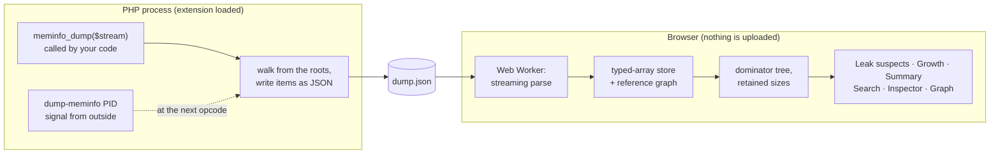
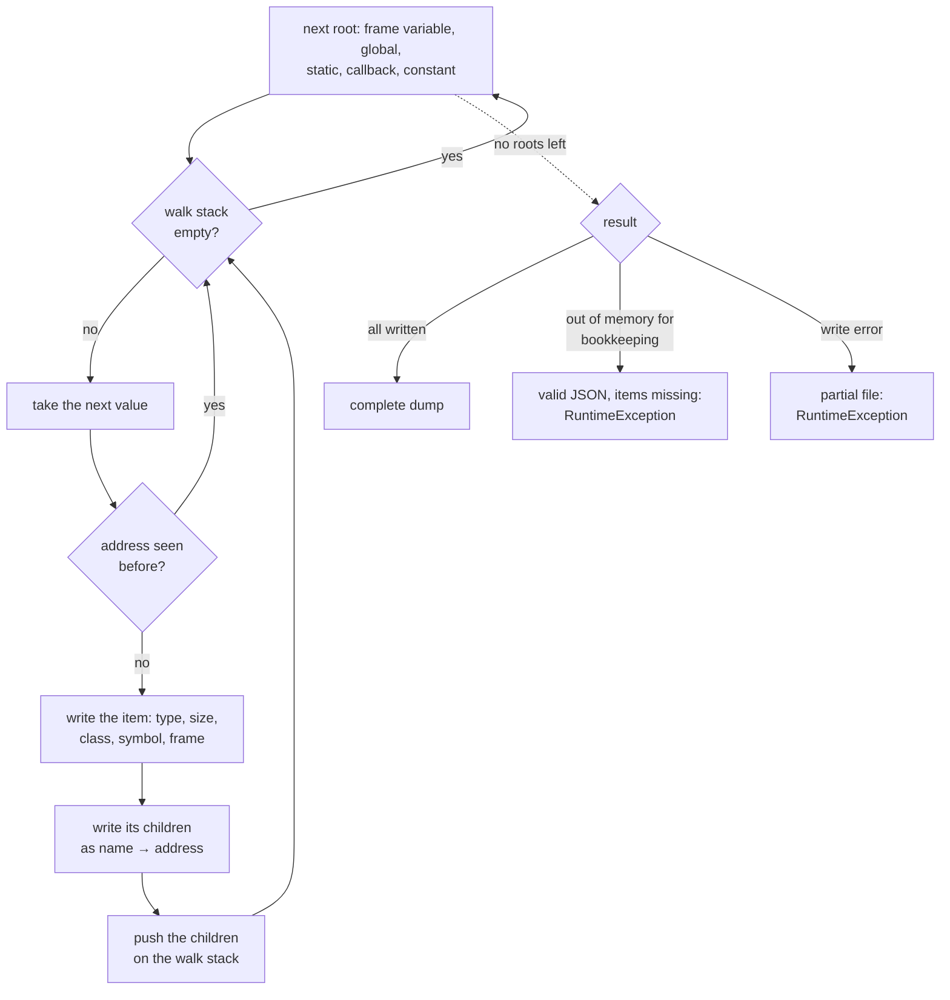
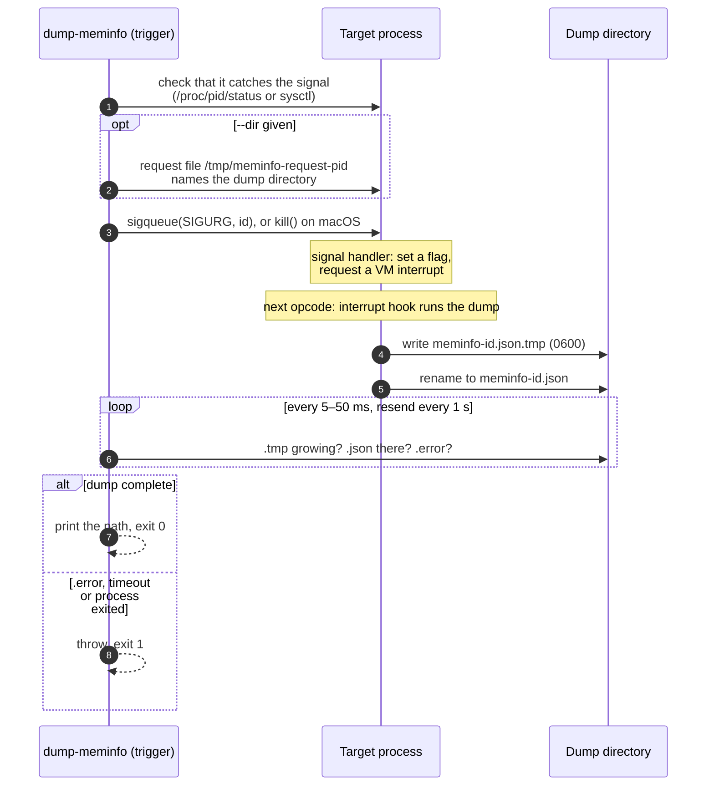

MEMINFO
=======


PHP Meminfo is a PHP extension that writes the content of PHP memory to a JSON file: every array,
object and value still reachable, the variable or static it hangs from, and what refers to what. Its
main goal is to help you find memory leaks in long-running PHP processes. The dump is analyzed in a
[browser UI](https://vantafinance.github.io/php-meminfo/) that runs entirely in your browser and
points at what keeps memory alive and what grows. A process can be dumped from its own code with
`meminfo_dump()`, or from outside, while it runs, with `dump-meminfo <pid>`.

One of the main sources of inspiration for this tool is the Java jmap tool with the `-histo` option.

Compatibility
-------------

Minimum supported version: **PHP 7.0**. Supported: PHP 7.0 – 8.5 (tested in CI on every version).
Dumping another, running process needs the target to be PHP 7.1 or later, non-ZTS, on POSIX.

Installation
------------

Two packages:

| Package | What | Installed with |
|---|---|---|
| `vanta/meminfo` | the extension: `meminfo_dump()`, `meminfo_dump_process()` | [PIE](https://github.com/php/pie) |
| `vanta/dump-meminfo` | the `dump-meminfo <pid>` command | Composer |

### With PIE (recommended)

[PIE](https://github.com/php/pie) is the official installer for PHP extensions, the successor of
PECL. It builds the extension for your PHP, installs it and enables it in the right ini file
(`phpenmod`, `docker-php-ext-enable`, the scan directory or `php.ini`).

Install PIE once (it needs PHP 8.1+ to run, but installs into any PHP version):

```bash
$ curl -fL --output /tmp/pie.phar https://github.com/php/pie/releases/latest/download/pie.phar \
    && gh attestation verify --owner php /tmp/pie.phar \
    && sudo mv /tmp/pie.phar /usr/local/bin/pie \
    && sudo chmod +x /usr/local/bin/pie
```

Then install the extension, including S3 support, and check that it is loaded:

```bash
$ pie install vanta/meminfo
$ php --ri meminfo
```

On supported glibc Linux and macOS x86_64/arm64 builds, the package prepares pinned vcpkg/AWS CRT
dependencies automatically. Install the [native build tools](doc/process_dump.md#building-with-s3)
first; the initial source build needs network access and can take several minutes.
This automatic behavior applies to this development revision; published `0.2.0` still needs the
[explicit-prefix recipe](doc/process_dump.md#advanced-explicit-prefix-builds) until a release includes it.

| Need | Command |
|---|---|
| Without S3 (including Alpine/musl) | `pie install vanta/meminfo --with-meminfo-s3=no` |
| Build diagnostics | `MEMINFO_BUILD_VERBOSE=1 pie -v install vanta/meminfo` |
| A specific version | `pie install vanta/meminfo:^0.1` |
| Another PHP installation (e.g. PHP 7.4 next to 8.4) | `pie install --with-php-config=/usr/bin/php-config7.4 vanta/meminfo` |
| A custom reported version or copyright year | `pie install vanta/meminfo --with-meminfo-version=0.1.0-custom --with-meminfo-copyright-year=2026` |
| Install without touching ini files | `pie install --skip-enable-extension vanta/meminfo`, then [enable it](#enabling-the-extension) yourself |

PIE writes into the system extension and ini directories, so it may ask for your password. In CI or
another non-interactive shell, run it as root: it does not call `sudo` itself without a terminal.
Windows is not supported. NTS and ZTS builds both work, but only NTS can be
[dumped from outside](#dumping-a-running-process).

### The `dump-meminfo` command

```bash
$ composer require --dev vanta/dump-meminfo
$ vendor/bin/dump-meminfo <pid>
```

It is a thin wrapper over `meminfo_dump_process()`, so the extension has to be loaded for the PHP
that runs it, as well as in the process it dumps. `make install-cli` installs it from a checkout
instead (see below).

### Docker

With PIE, in your own glibc-based image. Use the same PHP base for builder and runtime so their
PHP ABI, libc and architecture match. The runtime only needs the statically linked extension:

```dockerfile
FROM php:8.4-cli AS base
FROM base AS builder
RUN apt-get update && apt-get install -y --no-install-recommends \
    $PHPIZE_DEPS cmake ninja-build pkg-config linux-libc-dev git curl \
    ca-certificates zip unzip tar perl libtool
RUN --mount=type=bind,from=ghcr.io/php/pie:bin,source=/pie,target=/usr/local/bin/pie \
    pie install --no-interaction --skip-enable-extension vanta/meminfo
FROM base
COPY --from=builder /usr/local/lib/php/extensions/ /usr/local/lib/php/extensions/
RUN docker-php-ext-enable meminfo && php --ri meminfo
```

No vcpkg checkout or AWS library prefix is needed. For an Alpine image, explicitly disable S3
with `--with-meminfo-s3=no`. See [build modes and caching](doc/process_dump.md#building-with-s3).

`make docker-build PHP_VERSION=8.1` builds a ready image (`meminfo:php-8.1`) from the repository
`Dockerfile`; see [Development](doc/development.md) for the Docker test matrix and the IDE setup.

### From source

A `Makefile` in the repository root wraps the build. Run `make help` to list every target.

```bash
$ make build          # build the extension (phpize + configure + make, as needed)
$ make install-ext    # install it into the PHP extension directory (may need sudo)
$ make install-cli    # install the dump-meminfo command into $(PREFIX)/bin, default /usr/local
$ make test           # run the extension's .phpt suite
```

To build against a specific PHP installation, override the toolchain variables:

```bash
$ make build PHPIZE=/usr/local/php-7.4/bin/phpize PHP_CONFIG=/usr/local/php-7.4/bin/php-config
```

The reported version and copyright year are build arguments (`make build MEMINFO_VERSION=2.1.0`); see
[Development](doc/development.md#version-and-copyright-year).

S3 is built by default; `make build MEMINFO_S3=no` produces a lightweight build without native
S3 dependencies. `MEMINFO_S3=auto` prepares dependencies; an existing prefix is also accepted.
See [Building with S3](doc/process_dump.md#building-with-s3) for prerequisites and offline builds.

Without Make, from the `extension` directory:

```bash
$ phpize
$ ./configure --enable-meminfo
$ make
$ make install
```

### Enabling the extension

PIE does this for you. After a build from source (or `--skip-enable-extension`), add the following
line to your `php.ini`:

```ini
extension=meminfo.so
```

### Settings

All settings are `PHP_INI_SYSTEM`. All are off by default except the dump signal. The signal,
deferred, `memory_limit` and threshold dumps need the same build as signal dumps: PHP 7.1 or later,
non-ZTS, POSIX. Elsewhere they are ignored with a warning at startup.

| Setting | Default | Meaning |
|---|---|---|
| `meminfo.dump_signal` | `SIGURG` | Signal the process dumps on, by name or number. `0` or empty disables it. |
| `meminfo.dump_dir` | system temp dir | Where dumps are written unless the trigger passes `--dir`. |
| `meminfo.dump_defer` | `0` | A dump signal only records the request; the dump is written when the code calls `meminfo_dump_if_requested()` (between two jobs of a worker). |
| `meminfo.dump_on_limit` | `0` | Capture a reported memory-limit fatal before the request ends. Engines that terminate directly through `_exit` cannot provide this callback. |
| `meminfo.dump_threshold` | empty | Attempt one early dump per request after used PHP memory crosses it: `512M`, `1G`, or `80%` of a finite `memory_limit` (PHP 8.0+). |
| `meminfo.dump_unreachable` | `0` | Default of the `unreachable` dump option, for dumps taken on a signal or a limit. |
| `meminfo.dump_string_hashes` | `0` | Default of the `string_hashes` dump option, likewise. |
| `meminfo.auto_mark` | `0` | Every dump starts a new [generation](#generations-and-histograms) first. |
| `meminfo.track_allocations` | `0` | Record the line of the `new` that created each object. It costs about 6 ns per `new`, and the opcache JIT does not run while it is on. |
| `meminfo.dump_upload` | empty | `s3://bucket[/prefix]`: also upload every dump the process writes on its own, in the background. Included in default builds; disabled with `--with-meminfo-s3=no`; `meminfo.dump_upload_keep_local`, `meminfo.dump_upload_timeout` and `meminfo.s3_region` / `s3_endpoint` / `s3_path_style` go with it — see [Uploading dumps to S3](doc/process_dump.md#uploading-dumps-to-s3). |

`php -i | grep meminfo` shows what a build resolved. Details, and why `SIGURG`, are in
[Dumping a running process](doc/process_dump.md#settings).

Usage
-----

### Dumping memory content

```php
meminfo_dump(fopen('/tmp/my_dump_file.json', 'w'));
```

This writes a dump of the PHP memory, as JSON, to the given stream: a file, or `php://stdout`. It
throws `RuntimeException` when the stream cannot be written to, or when the dump is incomplete. [`doc/example.php`](doc/example.php)
is a minimal script (`make dump-example` runs it).

Two options, both off by default:

```php
meminfo_dump($stream, [
    'unreachable'   => true, // objects still alive that no root reaches: uncollected cycles, objects held by C code
    'string_hashes' => true, // a hash of each string of 32 bytes or more, to find duplicates (shorter ones are never hashed)
]);
```

### Generations and histograms

```php
meminfo_mark();                          // objects alive now are generation 1; objects created later are newer
// … run the job …
meminfo_dump($stream);                   // every object carries the generation it was first seen in

$histogram = meminfo_histogram();        // ['App\Entity\User' => ['count' => 120, 'size' => 8640], …]
file_put_contents('histo-' . time() . '.json', json_encode(['timestamp' => time(), 'classes' => $histogram]));
```

Objects of an old generation that are still alive several jobs later are what a leak looks like.
`meminfo_histogram()` reads only the object store: it builds no graph and writes no JSON, so it is
cheap enough to call every few minutes. The browser UI compares any number of these files.

### Dumping a running process

When a worker is already running and leaking, ask it for a dump from outside, without changing or
restarting it. The target only needs the extension loaded; it writes the dump at the next safe point
between two opcodes, and the command prints its path:

```bash
$ dump-meminfo <pid> [--dir=DIR] [--signal=SIG] [--timeout=SEC] [--force] [--count=N --interval=TIME]
$ dump-meminfo 12345 --dir=/tmp
/tmp/meminfo-1834201933.json
$ dump-meminfo 12345 --count=3 --interval=5m     # a series: open the three files together in the UI
```

The same from PHP: `$path = meminfo_dump_process(12345, ['dir' => '/tmp']);`. Every failure throws;
the command exits with 1 on a runtime failure and 2 on bad usage. Under php-fpm, only a worker that is
serving a request can be dumped — take its pid from the status page, never the master's.

A worker can also dump itself: at a quiet point between two jobs (`meminfo.dump_defer`), when
`memory_limit` is reached (`meminfo.dump_on_limit`), or once memory usage passes a threshold
(`meminfo.dump_threshold`). Those dumps can also be [uploaded to S3](doc/process_dump.md#uploading-dumps-to-s3)
(`meminfo.dump_upload`), so a dump outlives an ephemeral pod; `dump-meminfo --wait-upload` then
prints the `s3://` location. Errors, settings, worker recipes, FPM, containers, security and
limitations are covered in [Dumping a running process](doc/process_dump.md).

### Analyzing a dump in the browser

Open <https://vantafinance.github.io/php-meminfo/> and drop the dump on the page. The page is static:
the dump is read and analyzed in your browser and never leaves it. To run it locally (Node 24+):

```bash
$ make ui-install
$ make ui-dev         # then open the printed URL
```

It shows:

- **Leak suspects**: what retains the most memory, by item, class and frame, and where the objects
  were created (with `meminfo.track_allocations`).
- **Findings**: patterns that usually mean a leak or waste, each with a hypothesis and what to check
  next. They include holders of many small items, a dominant class, cycles, many closures from one
  line, sparse arrays, duplicate strings, unreachable objects, and memory held by no item.
- **How held**: the instances of a class grouped by the shape of their path from a root, with all
  paths merged into one tree.
- **Ignored holders**: exclude a cache, a logger or framework internals, and everything is
  recomputed. The filter is kept in the URL.
- **Growth** against earlier dumps of the same process:
  - open a series (`dump-meminfo --count`) to see what grows at every step;
  - objects created between the first two dumps and still alive in the last are listed as leak
    candidates;
  - you can also load generations and `meminfo_histogram()` files.
- **Summary, top children, search**, and for any item every reference path from a root and a graph
  of what keeps it reachable.

The same analysis runs without a browser, for CI:

```bash
$ cd ui && npm ci && npm run build:report
$ node dist-report/cli.js after.json --baseline=before.json --fail-on=high --max-growth=1000 > report.json
```

`--format=html` writes a standalone page instead of JSON. The command exits with 1 when a rule
trips. The rules that tripped go to stderr without names from the dump, unless `--show-names` is
given. See `ui/README.md` for building and testing the UI.

[Hunting down memory leaks](doc/hunting_down_memory_leaks.md) walks through a real investigation with
it, step by step.

How it works
------------

### Overview

The extension writes a snapshot of everything the program can still reach as one JSON file. The UI
turns that file into a graph and asks which items keep the most memory alive.



### What a dump contains

The walk starts from every root, in this order, and follows every reference it finds:

1. The execution frames of the current call stack, then the frames of suspended Fibers (PHP 8.1+).
   Besides its variables, a frame holds more:
   - `$this`;
   - the running `{closure}`;
   - arguments beyond the declared ones and every argument of an internal call (`[arg N]`,
     `[named args]`);
   - live temporaries, such as the array a `foreach` iterates over (`[tmp]`);
   - arguments already passed to a call not made yet (`[pending arg]`).
2. The global variables.
3. Static properties of classes, and class constants holding objects, such as enum cases
   (`<CLASS_CONSTANT>`).
4. `static` variables of functions and methods.
5. Registered callbacks (`<CALLBACK>`):
   - error and exception handlers, shutdown functions and output buffer handlers;
   - autoloaders and tick functions;
   - `header_register_callback()`, the session save handler and `pcntl_signal()` handlers;
   - the libxml external entity loader (8.2+) and the options of the default stream context.
6. User constants that hold arrays or objects.
7. Output buffers, as items of type `buffer` (`<OUTPUT_BUFFER>`).
8. With the `unreachable` option, objects still alive that none of the above reaches
   (`<UNREACHABLE>`).

Each allocation reached is written once, as an item keyed by its address:

- an object is keyed by the object;
- a refcounted string or array is keyed by its `zend_string` or `zend_array`.

So many variables pointing at one value give one item. A lazy object (8.4) also leads to its
initializer, or to the real instance once a proxy is initialized, and nothing is initialized by
the dump. A fiber also leads to the callable it was created with and to its return value.
Not reached: the context set by `libxml_set_streams_context()`, stream notification callbacks, and
the stacks of Swoole coroutines that are not suspended Fibers. An item lists its children by name
and address before they are visited. The walk uses its own stack instead of C recursion, so deep
structures cannot overflow it. Reading an object never calls PHP code (`__get`, `__debugInfo`) and
never builds a property table that the object did not have.



The writer allocates its buffer outside PHP's memory manager, so a dump does not count against
`memory_limit`. A regular file is written directly. Other streams (sockets, pipes, filtered or
userspace streams) are spooled to a temporary file first and copied once the walk is over, so no
PHP code runs in the middle of it. The `size` of an item is the allocation it stands for:

- an object's struct with its property slots and property table;
- an array's header, slots and hash index, plus its string keys;
- a string's header and characters;
- a stream's buffers and, for `php://memory`, its content.

Scalars and interned strings live inside their holder and count 0.

### How a running process is dumped

Code cannot run safely inside a signal handler, so the handler only leaves a flag. The dump is
written at the next point where the Zend VM checks for interrupts, which is between two opcodes.
The file appears under its final name only once it is complete.



While it dumps, the target pauses the `max_execution_time` timer and lifts `memory_limit`, then
restores both. Nothing is written to its output. A process blocked in an idle event loop runs no
opcode and so cannot answer until it wakes up. Settings, security checks, FPM and containers are in
[Dumping a running process](doc/process_dump.md).

### The dump format

```json
{
  "header": {"memory_usage": 2097152, "memory_usage_real": 2097152, "peak_memory_usage": 2097152, "peak_memory_usage_real": 2097152,
             "identity_model": 2, "size_model": 2, "php_version": "8.4.1", "sapi": "cli", "pid": 4242, "rss": 31457280, "…": "…"},
  "items": {
    "0x7f2a4c05e0c0": {"type": "array", "size": "128", "symbol_name": "users", "is_root": true, "frame": "<GLOBAL>",
                       "children": {"0": "0x7f2a4c062a00"}},
    "0x7f2a4c062a00": {"type": "object", "size": "72", "is_root": false, "class": "User", "object_handle": "3",
                       "children": {"name": "0x7f2a4c062a28"}}
  }
}
```

- `items` is keyed by address. Addresses only identify an item within one dump.
- `children` maps a property name or array key to the address of another item. The graph follows
  these edges.
- `is_root` items carry `symbol_name` and `frame`: the variable name and where it lives (`func()`,
  `Class->method()`, `<GLOBAL>`, `<CLASS_STATIC_MEMBER>`, `<CLASS_CONSTANT>`, `<STATIC_VARIABLE>`,
  `<CALLBACK>`, `<CONSTANT>`, `<OUTPUT_BUFFER>`, `<UNREACHABLE>`). The roots of a frame also carry
  `line`, the line the frame is at.
- Optional item fields:
  - `function` and `declared_at` for closures;
  - `resource_type` for resources;
  - `capacity` and `used` for arrays;
  - `hash` with `string_hashes`;
  - `generation` after `meminfo_mark()`;
  - `site` with `meminfo.track_allocations`.
- The header describes the process: version, SAPI, pid, time, `memory_limit`, `rss`, GC counters,
  the VM stack and the number of classes and functions compiled. `trigger` says what the dump was
  taken on: `call`, `deferred`, `signal`, `threshold` or `memory_limit`. The last three were taken in
  the middle of the work, and the UI says so when it compares them.
- `identity_model` and `size_model` are 2 since items stand for allocations. The UI still reads
  older dumps.

### Analysis in the browser

The UI reads the file as a stream in a Web Worker, without ever holding the whole text. It stores
the items in typed-array columns, with the references as a compact edge list. From a virtual root
pointing at every `is_root` item, it computes the dominator tree. An item's **retained size** is
everything that would be freed if that item went away. **Leak suspects** are the items and classes
that retain the most. **Growth** compares the counts and sizes per type and class against an
earlier dump of the same process. The page only receives the rows and subgraphs it displays. It
sends nothing anywhere, and its Content Security Policy only allows connections to the page's own
origin, so the dump never leaves your machine.

Other memory debugging tools for PHP
------------------------------------

- [Xdebug](https://xdebug.org/): its trace feature with memory deltas shows memory usage per function.
- [PHP Memprof](https://github.com/arnaud-lb/php-memory-profiler): aggregated memory usage by
  function, far less resource intensive than a full Xdebug trace.

FAQ
---

### `memory_usage` is much higher than what the dump accounts for

A lot of memory is used by the Zend Engine itself (compiled code, the virtual machine, the garbage
collector) and by extensions. PDO and mysqli, for example, buffer whole result sets in PHP memory by
default ([buffering](https://www.php.net/manual/en/mysqlinfo.concepts.buffering.php)), and image
extensions hold large buffers. All of it goes through the Zend Memory Manager, so it counts towards
`memory_get_usage()` and `memory_limit`, but meminfo only sees the data structures of your program,
not the extensions' own memory. Hence the gap, which can be large.

The UI shows the size of that gap. It also reports when the process (`rss` in the header) is much
bigger than what PHP allocated, which points at memory allocated outside PHP. A header
`user_class_count` that grows from dump to dump means code is being compiled at runtime (`eval()`,
proxy generators) and never freed.

### "Call to undefined function" when calling `meminfo_dump`

The extension is not enabled. Look for the meminfo section in `php -i` (or a `phpinfo()` page) and
check the `extension=meminfo.so` line of the `php.ini` that PHP actually loads (`php --ini`).

### Why are most tests "skipped"?

The tests need JSON support, but `make test` runs them in a clean environment that loads no shared
extensions. If JSON is built as a separate extension (common before PHP 8), they are skipped. Run them
with your own configuration from the `extension` directory:

```bash
$ TEST_PHP_EXECUTABLE=$(which php) $(which php) run-tests.php -d extension=$PWD/modules/meminfo.so
```

More on building and testing in [Development](doc/development.md).

Credits
-------

Thanks to Derick Rethans for his inspirational work on the essential Xdebug. See https://xdebug.org/
